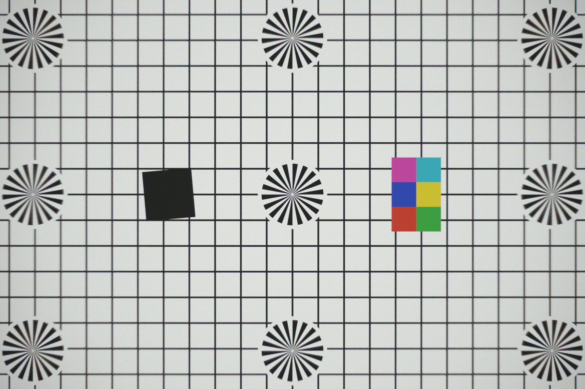
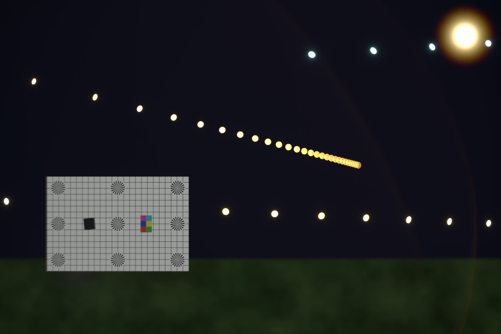
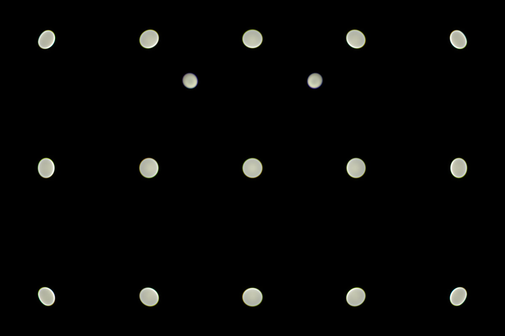
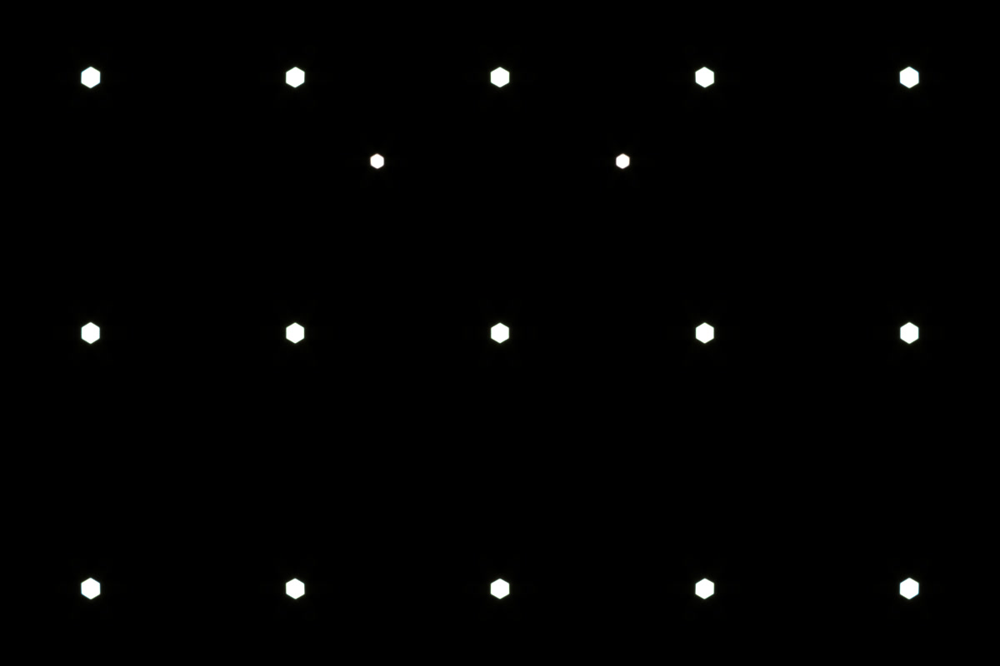
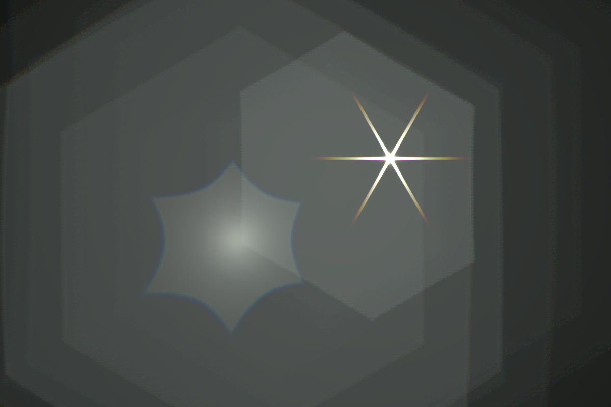
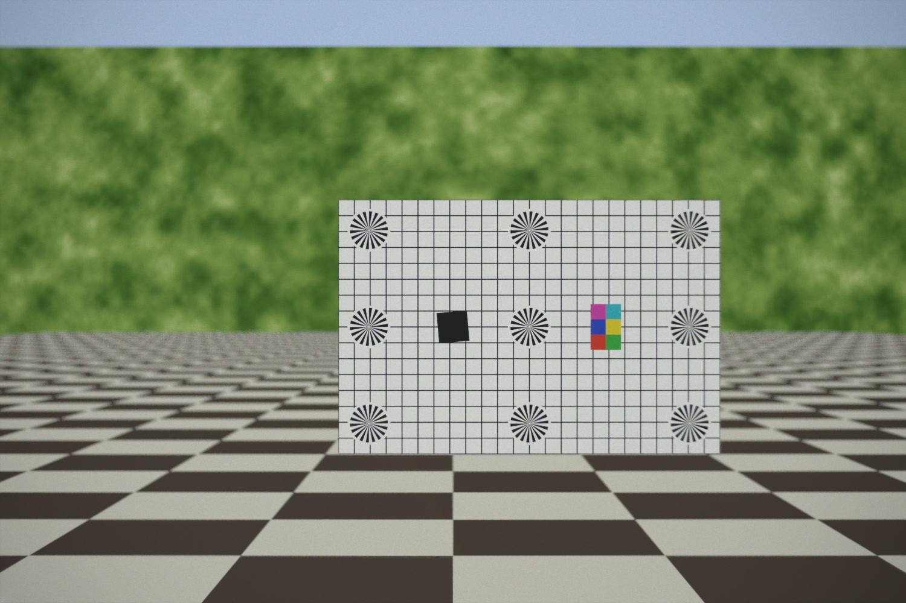
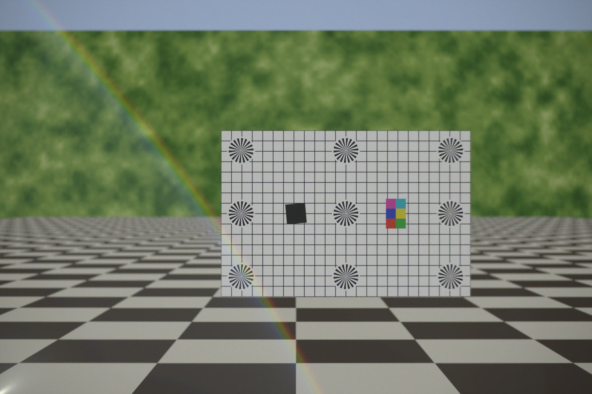
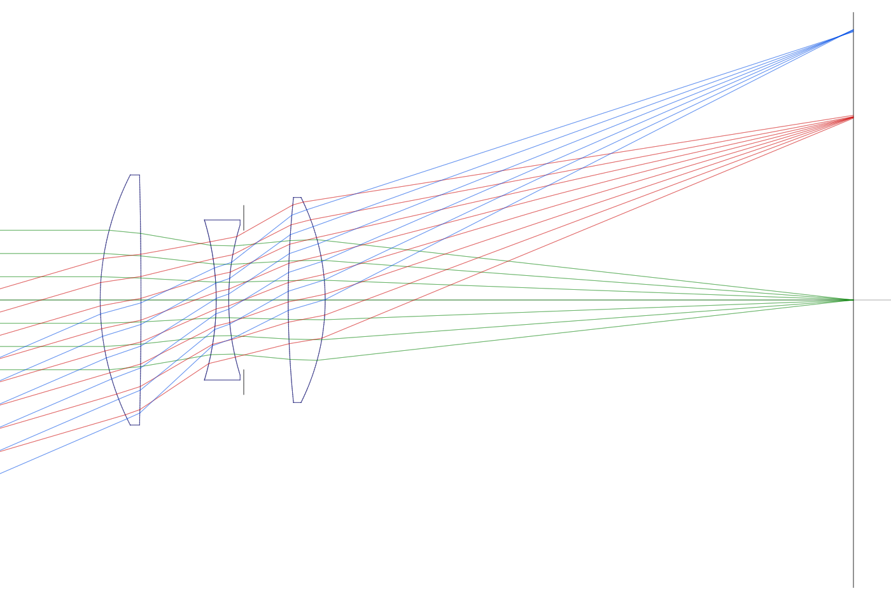
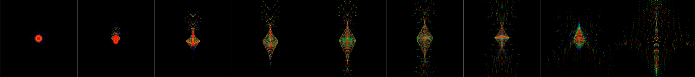

# lens-render

Physically based, spectral simulation of a photographic lens. Rays are traced
through the real lens prescription, so the image shows the lens'
imperfections because they emerge from the optics, not from post effects.

Lenses: a 50 mm f/3.5 Cooke triplet (`lenses/cooke-triplet.lens`) and a
50 mm f/2 double Gauss with cemented doublets (`lenses/double-gauss.lens`,
e.g. `--set lens=../lenses/double-gauss.lens`).

## What is simulated

| Effect | How |
| --- | --- |
| Spherical aberration, coma, astigmatism, field curvature, distortion | Exact ray tracing through spherical surfaces (Snell's law) |
| Longitudinal and lateral chromatic aberration | Spectral rendering, 380–780 nm; Sellmeier dispersion of the Schott glasses |
| Natural vignetting (cos⁴) and mechanical vignetting (cat's-eye bokeh) | Sampling through the real exit pupil; clipping at element clear apertures |
| Transmission losses, coating tint | Fresnel equations; uncoated or single-layer MgF₂ quarter-wave coating (thin-film interference) |
| Ghosts (lens flare) | All two-reflection paths, traced from each light as a ray grid and rasterised (noise-free, with caustics) |
| Veiling glare | The same ghost paths sampled from the sensor for bright scene surfaces |
| Diffraction, star bursts | Fraunhofer PSF of the iris shape per wavelength, convolved with the image |
| Bokeh shape | Iris with straight or curved blades; round when wide open |
| Focus breathing | Unit focusing; best focus found like contrast AF (minimum RMS blur) |
| Manufacturing errors | Optional lateral decentering of individual elements (one-sided softness) |

## Gallery

Rendered with `scripts/gallery.sh`.

Test chart at 2 m, f/3.5: sharp centre; astigmatism, lateral colour and
vignetting towards the corners.


Night, focused at 1.5 m, f/3.5: cat's-eye bokeh, colour-fringed bokeh rims,
diffraction glow and a faint ghost arc from the street lamp.


Point lights behind and in front of the focus plane at f/3.5 and f/8:
bright green-rimmed discs behind focus, softer purple-rimmed ones in front
(spherical aberration plus longitudinal colour), cat's eyes in the corners
wide open, hexagons stopped down.



A bright light through the uncoated lens at f/8: iris-shaped ghosts, a
caustic ghost and the six-pointed diffraction star.


Sun just outside the frame, single-coated vs. uncoated:



Layout and spot diagrams (0–23.4° field, 200 µm boxes):



## Usage

```sh
cargo build --release

# Interactive viewer: progressive GPU rendering with live lens controls.
./target/release/lens-render view scenes/night.toml

# Optical analysis: paraxial data, aberrations vs. field, spot diagrams, layout.
./target/release/lens-render analyze lenses/cooke-triplet.lens --out analysis

# Render a scene on the GPU; writes out.png and a linear out.exr.
./target/release/lens-render render scenes/chart.toml -o chart.png
./target/release/lens-render render scenes/night.toml -o night.png --set fstop=8 --set spp=256

# The CPU reference renderer (used automatically if there is no GPU).
./target/release/lens-render render scenes/chart.toml -o chart.png --cpu
```

Any `[camera]` key can be overridden with `--set key=value`.
`LENS_PROFILE=1` prints GPU pass timings.

### Viewer

Controls for f-number, focus distance (or click the image to focus there),
iris blades, blade curvature and rotation, coating, ghosts, diffraction,
exposure, tone curve and resolution. Accumulation restarts on lens changes;
exposure and tone curve apply without restarting. Diffraction switches on
after 8 frames, once the image has settled. "Save PNG" writes `view.png`.

### Speed

Apple M2 Max, 1200×800, 16 spectral samples per pixel per frame:

| Scene | GPU frame | Viewer |
| --- | --- | --- |
| Chart | 11 ms | 59 fps (vsync) |
| Night (53 lights, ghosts) | 23 ms | 37 fps |
| Bokeh (17 lights, ghosts) | 26 ms | 32 fps |

The diffraction convolution takes 14 ms at f/3.5 and 26 ms at f/16. A
256-sample render of the night scene takes about 1 s, against about 20 s on
the CPU.

### Scenes

TOML, metres, x right, y up, z = distance in front of the lens' front vertex.

```toml
background = [0.0, 0.0, 0.0]        # linear RGB radiance

[camera]
lens = "../lenses/cooke-triplet.lens"
width = 1200                        # pixels; height follows the sensor aspect
sensor_width_mm = 36
sensor_height_mm = 24
fstop = 5.6                         # omit for wide open
focus_distance = 2.0                # metres, or inf
focus_offset_mm = 0.0               # manual focus shift of the sensor
coating = "single"                  # or "none"
iris_blades = 6
iris_rotation_deg = 0
iris_curvature = 0.0                # 0 straight blades, 1 circular
decenter = [[1, 0.1, 0.0]]          # element 1 (0 = front) shifted 0.1 mm in x
spp = 64                            # samples per pixel (scene surfaces)
light_samples = 4000000             # per light, direct image (CPU renderer)
ghost_grid = 128                    # ray grid per light and ghost path
ghost_threshold = 0.01              # ghosts only for lights ≥ 1% of the brightest
ghosts = true
diffraction = true
spectral_bins = 16
exposure_ev = 0
tonemap = "clip"                    # or "filmic"

[[object]]
type = "plane"                      # emissive textured rectangle
center = [0, 0, 2.0]
size = [1.5, 1.0]
rotate = [0, 0, 0]                  # degrees about x, y, z
brightness = 1.0
texture = { kind = "chart" }        # chart | grid | checker | noise | color | image

[[object]]
type = "light"                      # small spherical light
center = [1, 0.5, 8]
radius = 0.02
temperature = 3000                  # black body, or color = [r, g, b]
radiance = 5000                     # luminance relative to a white surface

[[object]]
type = "light_string"               # evenly spaced lights from `from` to `to`
from = [-1, 0, 3]
to = [2, 0.5, 20]
count = 20
radius = 0.005
temperature = 2700
radiance = 300
```

Image textures: `texture = { kind = "image", path = "photo.jpg" }` (path relative to the scene file).

Exposure is normalised by 4N²/π, so a white surface renders near 1.0 at the
image centre at any f-number.

### Lens files

```
@name Cooke triplet 50mm f/3.5
# radius   thickness   material   semi-diameter
 22.01359  3.25896     N-SK16     10.0
 stop      3.55041     air        5.57
```

Radius `inf` is flat; `stop` marks the iris. Aspheric surfaces take extra
`key=value` columns: `k=<conic>` and `a4=`, `a6=`, … `a18=` for
z(r) = c r² / (1 + √(1 − (1+k) c² r²)) + Σ a₂ᵢ r²ⁱ. Floating elements:
`@float <row> <gap at infinity> <gap at close focus> <close distance in m>`
makes the thickness of that row vary linearly in object vergence. Materials are `air`, a
catalogue glass (N-BK7, N-SK16, F2, N-SF2, N-SF5, N-SF11, N-BAK1, N-LAK9,
FUSED-SILICA) or `nd/vd`, e.g. `1.62041/60.32`. The last thickness is the
nominal distance to the image plane; focusing moves the sensor.

## The Cooke triplet

`analyze` output at f/3.5, focused at infinity:

- EFL 50.02 mm, BFD 42.44 mm, f/3.5
- On-axis RMS spot 4.7 µm; ~50 µm at 15–19°, 64 µm in the corners
- Distortion −0.5 % (barrel)
- Lateral colour (F–C) 16 µm at the corner
- Strong astigmatism in the corners (tangential focus −1.3 mm)
- Relative illumination 58 % in the corners

## Verification

`cargo test --release` checks, among others:

- Glass indices and Abbe numbers against catalogue values.
- Real rays near the axis converge to the paraxial focus.
- Uniform scene renders to the lens' Fresnel transmission at the image centre.
- Backward (camera) and forward (light) tracing agree on the flux from a
  source within 1 %: on and off axis, f/3.5 to f/16, with a decentred element.
- Ghost energy from the backward pass matches the forward ray-grid ghosts
  within 4 % (5° and 17° field); the ray grid reproduces the direct image.
- Output images are upright.
- The GPU renderer matches the CPU reference: scene surfaces (also with a
  decentred element), direct light images, ghosts and veiling glare in total
  energy within 1 %; diffraction to f32 precision.
- Diffraction kernels equal a brute-force pixel integration of the PSF.

## Approach

- Scene surfaces: Monte Carlo tracing from the sensor through the lens.
  Directions are sampled on the rear element inside precomputed exit-pupil
  bounds; each wavelength bin gets its own low-discrepancy sample set.
- Lights: traced forwards from the light, direct images and ghosts as
  rasterised ray grids after Hullin et al., *Physically-Based Real-Time Lens
  Flare Rendering*, SIGGRAPH 2011 (the CPU renderer uses Monte Carlo for
  direct images).
- Film: per-pixel spectral irradiance in wavelength bins, convolved with the
  per-wavelength diffraction PSF, converted to sRGB via the CIE 1931 colour
  matching functions. Highlights far above white clip to white, as on a sensor.

GPU renderer (wgpu compute, WGSL):

- Nothing is specific to one lens: surfaces, refractive-index tables per
  medium (1 nm steps) and the event lists of the direct and all ghost paths
  are uploaded as data. Surfaces are intersected with a numerically stable
  vertex-relative formula that also covers flat ones.
- Progressive: every frame adds one sample per pixel and wavelength bin and
  re-jitters the light grids (wavelength, point on the light, grid offset),
  so lights converge to their true extent and spectrum.
- Each light's direct-image grid is sized to its footprint on the sensor;
  large ghost triangles and veiling glare go to a quarter-resolution film,
  as they are smooth.
- Diffraction kernels come from a summed-area table of the pupil's
  Fraunhofer pattern (exact pixel integrals); the convolution is a GPU FFT,
  two wavelength bins per complex transform.
- Native float atomics where the GPU has them, compare-and-swap otherwise.
